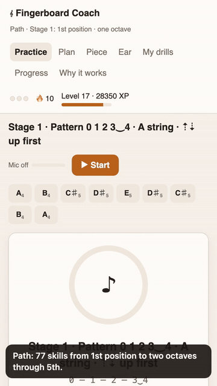

# Fingerboard Coach

**A violin practice app that listens while you play and tells you, note by note, what was in tune and what wasn't.**

It runs in the browser on a Mac, iPhone or iPad. There's nothing to install and no account, and your practice stays on your device.

**[Try it →](https://github.ekkylab.uk/violin-practice-system/)** (allow the microphone; add `?sim` to the URL to try it without a violin)


## Why I built it

I'm an adult learning the violin. I'm in my first few years, working on scales in 1st, 3rd and 5th position and on pieces like *The Two Grenadiers* and *Witches' Dance*. I have a lesson with my teacher every week. The rest of the week I practise alone.

That's where the trouble starts. In a lesson, my teacher hears a high 2nd finger straight away. At home I don't, or I notice something's off but not which note, which way or by how much. A tuner shows one note at a time and forgets it. So I'd spend the week practising the same mistake carefully.

I wanted something that sits in on my practice between lessons:

- **It hears every note**, scores it in cents and remembers where each finger tends to land.
- **It gives me a path to follow** instead of a list of exercises, and brings back what I've learnt before I lose it.
- **It keeps the violin under my chin**: I start a drill by playing its first note, and the next drill is already picked.
- **It works with Claude.** I can paste a report into a conversation, talk through what's going wrong and paste back drills and a practice plan written for me.
- **It's honest.** Plain numbers, stated criteria and no streak guilt. It's there to make the next lesson better, not to replace my teacher.

## See it in action

<table>
<tr>
<td width="33%" valign="top">

**Play a drill and see every note scored**


Both F♯s land about 30¢ sharp. The results name the note, show what the mastery level needs and suggest what to change.

</td>
<td width="33%" valign="top">

**Follow a path, not a menu**



77 skills, from one-octave scales in 1st position to two octaves through 5th. Next up plans each session.

</td>
<td width="33%" valign="top">

**Practise to a plan from Claude**


Claude writes the schedule, the app times each step and a report goes back for the next plan.

</td>
</tr>
</table>

<sub>These clips were recorded with sample progress and scripted audio (a synthesized violin-like tone), so the same run gives the same result every time. On a real violin, the app does exactly the same thing through the microphone.</sub>

## What it does

**🎯 Hears every note.** Each note is scored on where your finger first lands, in cents sharp or flat, and whether it was the right note at all (F instead of F♯). A fingerboard view shows roughly how far to move and which way. Medals tighten the target step by step: 🥉 ±25¢ → 🥈 ±15¢ → 🥇 ±10¢.

**🪜 A path from 1st to 5th position.** Finger patterns, then position frames, shift pairs and full scales, in the order the positions need. A skill unlocks once its groundwork is mastered. Every skill is played going up and coming down, because players tend to go sharp coming down. Mastered skills come back for review after 1, 2, 4, 7, 14 and 30 days.

**🎼 Any scale, any positions.** Free practice builds drills for any key and scale type, on any range of strings, in one to four positions. You get each string on its own, shifting drills and a full scale run that shifts where a violinist would. An adaptive Note Hunt picks your weakest notes more often.

**⏱ Tempo and rhythm.** A metronome mode scores each note on pitch and timing. A tempo ladder goes up only after 3 clean runs in a row. Rhythm drills cover dotted rhythms, long notes, rests and repeated notes, with ready-made packs for passages of real pieces.

**🎻 Whole pieces.** Record a piece without entering any music. The app splits it into notes, finds the ones that are consistently sharp or flat and marks where the tempo drifted. Each moment worth hearing again gets a ▶ button.

**👂 Ear training with your own violin.** *Flat or sharp*: hear a scale and catch the wrong note, down to a few cents. *Which string*: tell the G string from the D by its sound. Both quizzes can use recordings of your own instrument.

**🤖 Claude in the loop.** Every drill, practice session, piece and plan can be copied out as a report for Claude. Anything Claude writes (a custom drill or a weekly plan) can be pasted straight back in. No AI runs inside the app, and you choose what to share.

**🙌 Practise without putting the violin down.** Hands-free start: play a drill's first note to begin. Next up picks the drill after it. A timed Today card walks you through the day's session.

**🔒 Your data stays yours.** Everything works offline and stays in the browser. On my own hosted copy, optional sign-in syncs progress across devices; the public copy has no sign-in at all. Recordings never leave the device.

The [full guide](docs/guide.md) covers every feature, with the exact thresholds and rules.

## Built on how practice works

The app's choices come from music-education and motor-learning research, not guesses. The **Why it works** tab in the app explains each one:

- **Score the first landing.** In real playing there's no time to fix a note, so where your finger lands first is what counts.
- **Accuracy first, then speed.** The tempo goes up in small steps, and only once the notes are clean.
- **Coming down is its own skill.** String players play descending passages measurably sharper (Kantorski 1986; Sogin 1989), so both directions are scored separately.
- **Take the help away gradually.** Once a drill is done, hide the fingering or the needle so you don't come to depend on the feedback.
- **Mix and space your practice.** Reviews come back at growing intervals and in mixed order. That feels harder at the time, but you remember more.

Thresholds that don't come from a published source are labelled as starting defaults. You can tune them, and synthetic audio in the tests checks them.

## Try it

- **In your browser:** [github.ekkylab.uk/violin-practice-system](https://github.ekkylab.uk/violin-practice-system/). Chrome and Safari both work. On an iPad, turn on **iPad mic mode** in Settings.
- **Locally:**

  ```bash
  python3 -m http.server 8765
  ```

  Then open http://localhost:8765. The app has no build step and no dependencies.

[Development](docs/development.md) covers the tests, the file layout and the microphone diagnostics page.

## How it's made

I build Fingerboard Coach with Claude Code, one small, tested pull request at a time. Each change says what it was checked with. Alongside the app:

- **[Product Scout](scout/)** researches what violin learners at my stage struggle with and proposes features, each with evidence and its strongest reason *not* to build.
- **[The demo runner](demo/)** turns a proposal into a 60-second narrated video recorded against the real app, so I can decide from my phone.
- **[DECISIONS.md](DECISIONS.md)** records how the project is run and the alternatives that were rejected.
