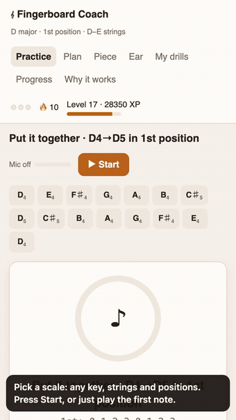
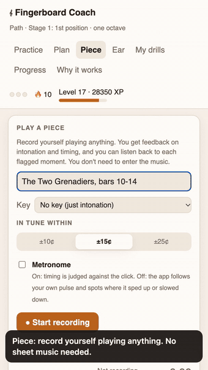
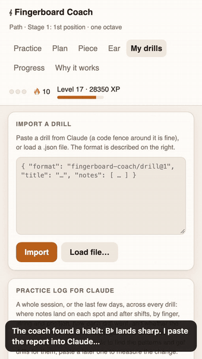
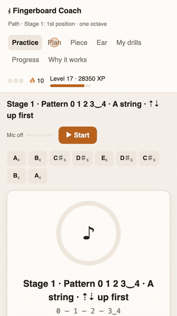

# Fingerboard Coach

**A violin practice app that listens while you play, tells you which notes were off and by how much, and helps you turn that into drills that fix them.**

It runs in the browser on a Mac, iPhone or iPad. There's nothing to install and no account, and your practice stays on your device.

**[Try it →](https://github.ekkylab.uk/violin-practice-system/)** (allow the microphone; add `?sim` to the URL to try it without a violin)


## Why I built it

I'm an adult learning the violin. I'm in my first few years, working on scales in 1st, 3rd and 5th position and on pieces like *The Two Grenadiers* and *Witches' Dance*. I have a lesson with my teacher every week. The rest of the week I practise alone.

My motivation for how I practise comes from **Molly Gebrian**, a violist with a background in cognitive neuroscience. In [*Learn Faster, Perform Better: A Musician's Guide to the Neuroscience of Practicing*](https://academic.oup.com/book/57630) (Oxford University Press, 2024), she treats practice as problem solving, not playing things through. You find the exact spot that's going wrong, work on it in short focused repetitions with breaks, and use your mistakes as information.

That's hard to do alone. In a lesson, my teacher hears a high 2nd finger straight away. At home I don't, or I notice something's off but not which note, which way or by how much. If I can't name the problem, I can't design practice for it, so I'd spend the week carefully repeating the same mistake.

So I built something that sits in on my practice between lessons:

- **It hears every note** and names what went wrong: which note, which finger, how many cents and roughly how many millimetres.
- **It turns that into practice.** Its coach notes are the starting point for drills aimed at exactly that problem. I design them with Claude, then measure whether they helped.
- **It listens to whole pieces**, not only exercises, and points me to the moments worth hearing again.
- **It keeps the violin under my chin**: I start a drill by playing its first note.
- **It's honest.** Plain numbers, stated criteria and no streak guilt. It's there to make the next lesson better, not to replace my teacher.

## See it in action

<table>
<tr>
<td width="50%" valign="top">

**1 · Every note scored**



A D major scale with a high 2nd finger. The coach's notes say every F♯ and C♯ lands 32¢ sharp, about 4.7 mm too far toward the bridge.

</td>
<td width="50%" valign="top">

**2 · A whole piece, then where to listen**



Record yourself playing anything, with no sheet music. It finds the habits (B♭ runs 22¢ sharp every time) and lists the moments to listen back to.

</td>
</tr>
<tr>
<td width="50%" valign="top">

**3 · Coach notes → a drill that fixes it**



The habit goes to Claude, a drill for it comes back. It's practised and scored like any other drill.

</td>
<td width="50%" valign="top">

**4 · A practice plan from Claude**



Claude writes the week's schedule, the app times each step and a report goes back for the next plan.

</td>
</tr>
</table>

<sub>These clips were recorded with sample progress and scripted audio (a synthesized violin-like tone with deliberate mistakes), so the same run gives the same result every time. On a real violin, the app does exactly the same thing through the microphone.</sub>

## From coach notes to drills

This is the loop I built the app for:

1. **Play.** A scale, a passage or a whole piece.
2. **Read the coach's notes.** They don't stop at a score. They name the problem in terms I can act on:
   - *"F♯4 (D string, finger 2, 1st) lands 32¢ sharp every time, about 4.7 mm too far toward the bridge. Aim a hair lower."*
   - *"Your shift down to …"*: whether it overshoots or stops short, and by how much.
   - *"You played F instead of F♯"*: the wrong note, and which way the finger pattern is off.
   - Rushing or dragging against the click, and whether shifts are making you late.
   - In a piece, notes that are *consistently* sharp or flat, which is a habit, not a slip.
3. **Design a drill for it.** Press **📋 Copy report for Claude** and paste it into a conversation. The report holds the drill, your recent runs note by note and the coach's notes. Claude writes a drill aimed at that problem in the app's drill format, for example the approach note into the sharp B♭, repeated, or the shift that keeps overshooting with a guide note. Paste it into **My drills → Import**. If something's wrong with it, the app gives error messages you can paste back.
4. **Practise it**, scored note by note, with medals that tighten the target: 🥉 ±25¢ → 🥈 ±15¢ → 🥇 ±10¢.
5. **Check whether it worked.** The **practice log** compares each imported drill's target notes before and after you added it, across *all* your practice, not just the drill. Paste a week's log into Claude to find the problems that keep coming back and plan the next round.

The drill format is documented in the app (**Copy format for Claude**) and in [`drills.js`](drills.js). Rhythm drills work too: give each note a length, and add rests.

## The Piece tab

Most of my practice time should end up in real music, so the app listens to pieces too. You don't need to enter the score:

- **Record** a whole piece or a passage, with or without a metronome. The app splits it into notes as you play.
- **Intonation:** each note against the nearest in-tune pitch, measured on the steady middle of the note (vibrato is measured at its centre). Notes that are consistently sharp or flat are listed, and so are notes outside the key if you pick one.
- **Timing:** with the metronome, each note against the click. Without it, your own pulse, how steady it was, and where you sped up or slowed down.
- **Moments to check:** the places worth hearing again, each with a ▶ button that plays that spot of the recording. A note 40¢ flat, a rushed bar, a stretch where the tempo crept up. Any note in the note chart can be played back too.
- **📋 Copy report for Claude** to talk through the performance and get drills for the weak spots. Record it again later and compare.

Past performances of the same piece are kept, so you can see a passage improve. The audio itself stays on the device and is gone when you leave the page.

## Everything else it does

- **🎼 Scales in any key and positions.** Pick a key and scale type, any range of strings and one to four positions. You get drills for each string, shifting drills, the full scale up and from the top, its rhythms, and an adaptive Note Hunt that picks your weakest notes more often. Next up suggests what to play after each run, and sends you to the build-up drill when misses cluster there.
- **⏱ Tempo and rhythm.** A metronome mode scores pitch *and* timing, and the tempo goes up only after 3 clean runs in a row. Rhythm drills cover dotted rhythms, long notes, rests and repeated notes, with ready-made packs for passages of real pieces.
- **👂 Ear training with your own violin.** *Flat or sharp*: hear a scale and catch the wrong note, down to a few cents. *Which string*: tell the G string from the D by its sound. Both quizzes can use recordings of your own instrument.
- **📅 Practice plans.** Claude writes a schedule, a timed Today card walks you through each session, and a plan report goes back for the next one.
- **🙌 The violin stays under your chin.** Hands-free start: play a drill's first note to begin, or the next drill's first note to move on.
- **🔒 Your data stays yours.** Everything works offline in the browser. On my own hosted copy, optional sign-in syncs progress across devices; the public copy has no sign-in at all. No AI runs inside the app: you choose what to paste to Claude.

The [full guide](docs/guide.md) covers every feature, with the exact thresholds and rules.

## Built on how practice works

The **Why it works** tab in the app explains the research behind each choice:

- **Specific, immediate feedback.** "Something's off" isn't enough: you need which way and how far.
- **Score the first landing.** In real playing there's no time to fix a note, so where your finger touches down is what counts, even if you slide it into tune afterwards. **Place** mode drills the opposite of sliding: stop, place, bow, and if it's off, lift it and place it again.
- **Move the finger, not the hand.** The coach checks whether the notes after an accidental (F♮ on the E string in a sharp key, say) or after a shift go off with it, against the same notes elsewhere.
- **Practise the hard part on its own**, then put it back in context: a drill for the problem, then the scale or passage again.
- **Accuracy first, then speed.** The tempo goes up in small steps, and only once the notes are clean.
- **Coming down is its own skill.** String players play descending passages measurably sharper (Kantorski 1986; Sogin 1989), so scales are also practised from the top.
- **Take the help away gradually.** Once a drill is done, hide the fingering or the needle so you don't come to depend on the feedback.

Every card on that tab names its sources and how strong they are (a study, a review, an expert's book, or established teaching advice), and says so when a rule is the app's own. The full list, with what each source was used for and whether it was read in full, is in [docs/references.md](docs/references.md). Thresholds that don't come from a published source are labelled as starting defaults. You can tune them, and synthetic audio in the tests checks them.

**Next, from Gebrian's book:** *Fix this note* and *Fix this progression*. They take the note a drill keeps missing, or the move into it, and run it as her microbreaks: three clean repetitions, a 10-second break, three more. It's a prototype for now.

## Try it

- **In your browser:** [github.ekkylab.uk/violin-practice-system](https://github.ekkylab.uk/violin-practice-system/). Chrome and Safari both work. On an iPad, turn on **iPad mic mode** in Settings.
- **Locally:**

  ```bash
  python3 -m http.server 8765
  ```

  Then open http://localhost:8765. The app has no build step and no dependencies.

[Development](docs/development.md) covers the tests, the file layout and the microphone diagnostics page.

## How it's made

I build Fingerboard Coach with Claude Code, one small, tested pull request at a time. Each change says what it was checked with. Alongside the app:

- **[Product Scout](scout/)** researches what violin learners at my stage struggle with and proposes features, each with evidence and its strongest reason *not* to build.
- **[The demo runner](demo/)** turns a proposal into a 60-second narrated video recorded against the real app, so I can decide from my phone.
- **[DECISIONS.md](DECISIONS.md)** records how the project is run and the alternatives that were rejected.
